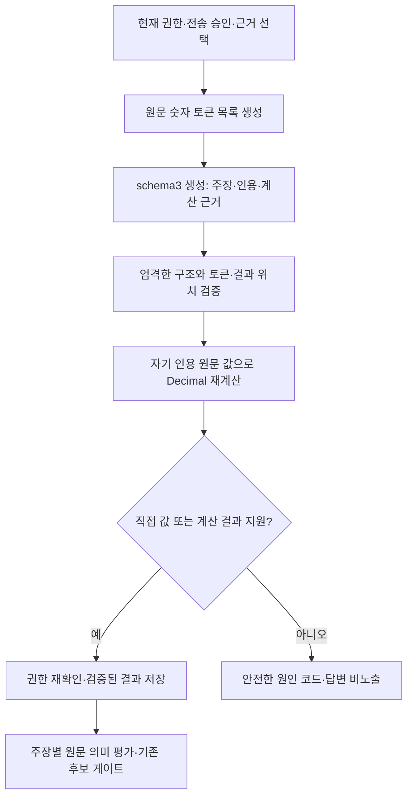

# 원문 기반 계산 근거와 숫자·날짜 진단 설계

- 상태: 명세·구현 계획 사용자 승인(2026-10-05), 코드 구현·독립 리뷰 보완 완료. 본래 migration·API·실모델 반영 전. [구현 기록](../../worklogs/2026-10-05-rag-numeric-proof-implementation.md).
- 날짜: 2026-10-05
- 결정: [ADR-0036](../../decisions/0036-rag-source-backed-calculation.md)
- 문제: 관리자 DB ISSUE-00026, 관련 ISSUE-00005
- 기준: [ADR-0035](../../decisions/0035-rag-exact-value-canonicalization.md), [실패7 진단](../../worklogs/2026-10-05-rag-failed7-diagnostic.md)

## 목적과 성공 기준

사용자의 목적은 특정 지급일이나 특정 질문의 예외 처리 없이 원문에서 질문의 문맥과 텍스트를
찾아 답하는 것이다. 이번 범위는 그중 원문에 직접 있는 값과 원문 값으로 계산한 결과를 구분해
인용 검증하는 계약이다. 유사도·검색·청킹 전체를 이 기능만으로 해결했다고 보고하지 않는다.

정상 파생값은 해당 주장에 인용한 원문 피연산자, 명시 연산, 단위와 결과 위치를 서버가 확인해야
한다. 잘못된 값·단위·부호·피연산자·위치·권한은 거절한다. 계산이 맞아도 원문의 상품·기간·관계가
다르면 의미 평가에서 통과할 수 없다. 기존 계정·자료·환경·결과와 직접 값 검증은 유지한다.

## 확인된 사실과 미확인 범위

| 대상 | 확인한 사실 | 확정할 수 없는 것 |
| --- | --- | --- |
| Q05 | 고정 QA가 두 비율의 차이를 요구하고 required 원문에는 비율이 직접 있으나 차이값은 없다. ADR-0035는 계산을 금지한다. | 실패한 정확한 문장·값·연산이 올바른지 |
| Q08 | 고정 QA는 금액·비율을 기대한다. required 두 unit은 단위 없는 셀 내용이다. 현재 parser는 이를 paragraph로 저장했고 unit/element의 table_cell이 모두 null이다. | 해당 실패가 단위 환산인지, 헤더 누락인지, 다른 값/자기 인용 문제인지 |
| Q12 | required 원문에는 연도를 포함한 완전한 날짜가 직접 있다. | 날짜 변경과 자기 인용 누락 중 무엇인지 |

formal rule의 Q05/Q08 `required_propositions=[]`를 QA 정답문과 혼동하지 않는다. 규칙·원문·QA의
역할을 구분하고 현재 실패 초안을 재구성하지 않는다. 재시도7의 종류 관측은 첫 거절 주장 내
미지원 고유값의 종류·개수이며 모든 주장이나 실제 값의 목록이 아니다.

Q08의 동결 payload에도 row/column/header 결속은 없다. 같은 원문 버전·projection·page2에서
금액 단위 문맥2개·평가금액 헤더1개·대상 행 라벨2개가 현재 DB와 동결 snapshot 양쪽에 있다.
숫자와 해당 문맥의 bbox 정렬도 확인했지만 모두 paragraph/table_cell=null로 저장돼 명시적인
단위→헤더→셀 관계는 없다. 원문 단위가 없다는 뜻이 아니라, 현재 전달 가능한 구조로 해당 셀의
금액 단위·헤더 결속을 서버가 입증할 수 없다는 범위다. Q12는 완전한 날짜 직접 지원을 유지한다.

## 대안과 범위

[ADR-0036](../../decisions/0036-rag-source-backed-calculation.md)의 세 대안 중 명시적인 계산 근거를
서버가 재검산하는 방식을 권고한다. 직접 값 제한은 유지하면서 계산값만 검증 가능한 형태로
확장한다. 가능한 숫자 조합 전체 탐색, 질문 ID별 예외와 LLM을 통한 계산 승인에 의존하지 않는다.

첫 구현 대상 연산은 두 가지다. 날짜는 기존 직접 값 동등성 검사만 한다.

| 연산 ID | 피연산자와 결과 | 계약 |
| --- | --- | --- |
| `percentage_point_difference` | 명시 `%` 토큰2개 → `%p` | 제출 순서의 왼쪽−오른쪽, 부호 보존. 절댓값 자동 적용이나 비율 나눗셈은 없다. |
| `convert_krw_unit` | 명시 원/만원/억원 토큰1개 → 같은 통화의 원/만원/억원 | 단위 승수 1/10^4/10^8만 사용. 정확한 유한 Decimal 결과이며 환율·반올림은 없다. |

연산 사슬·곱셈/비율 산출·일수/영업일·부분 날짜 보완·조건 추론은 이 첫 계약에 넣지 않는다.
새 연산은 정책 버전과 별도 검증으로 확장한다. 표의 단위 없는 숫자를 모델이 추측해 피연산자로
만드는 기능도 포함하지 않는다. 이 제한으로 Q08이 곧바로 해결된다고 약속하지 않는다.

## 모듈과 데이터 흐름

계산 업무 규칙은 `Labs/RAG/generation`의 독립 모듈에 둔다. Platform·API 핸들러·UI에 수식이나
숫자 지원 규칙을 넣지 않는다. 검색·권한·근거 선택 이후의 검증이므로 생성 프로파일 변경만으로
색인을 재생성하지 않는다.

### 서버 소유 토큰 목록

이번 요청의 승인된 생성 근거 원문에서만 목록을 만든다. 토큰은 opaque ID, evidence ID,
원문 내 반열림 시작/끝 위치, 종류·단위·정규화된 Decimal로 구성한다. 위치는 Python 문자열의
Unicode code point 인덱스이며 원문 텍스트를 변경하지 않는다. 부호·올바른 쉼표·소수 처리는
ADR-0035와 동등하다. 잘못된 쉼표, 유효하지 않은 날짜와 단위 없는 셀은 피연산자로 만들지 않는다.

목록은 요청/생성 프로파일/정책 버전/근거 내용 digest에 묶는다. 다른 요청의 ID, 소급 보충한 값,
선택되지 않은 근거와 현재 권한 밖 원문은 사용할 수 없다. section_path는 탐색 문맥이며 원문
단위나 표 헤더의 인용을 대신하지 않는다. 표 좌표만으로 헤더의 적용 관계를 추정하지 않는다.

명시 단위 토큰을 입력으로 제한하므로 아직 원문 구조에 없는 헤더→셀 결속은 새 파서 작업을
요구한다. 필요하면 별도 구조 계약으로 분리하고 이 명세의 계산 기능에 숨겨 추가하지 않는다.
parser/processing profile·source provenance가 바뀌면 새 호환 snapshot/projection과 필요한
색인 버전 경계를 적용한다. 원문 변경을 생성 프로파일만 바뀐 비교로 보고하지 않는다.

### schema3 응답

닫힌 구조를 사용한다. answered 응답은 `schema_version=3`, `status`, `claims`만 갖는다.
각 claim은 `text`, `evidence_ids`, `calculations`를 갖는다. 직접 값 주장은 calculations가 빈 목록이다.
insufficient 응답은 schema_version/status만 갖고, Codex wire는 빈 claims를 명시해 서버가 변환한다.

각 calculation은 `operation`, 순서 있는 `operand_token_ids`, `result_start`, `result_end`만 갖는다.
결과 값/단위는 주장 텍스트의 해당 원문 위치에서 서버가 파싱한다. 모델이 별도로 제출한 숫자,
임의 수식·코드·단위 승수·반올림·신뢰 점수는 허용하지 않는다.

schema3 주장 텍스트는 `text == text.strip()`을 요구하고 위반하면 거절한다. 텍스트를
strip/정규화/재작성해 위치를 고치지 않는다. 기존 GeneratedClaim의 strip이 유효 v3 텍스트를
바꾸지 않아야 한다. 공백뿐인 텍스트는 거절하고
완전한 숫자+단위 토큰만 result span으로 인정한다. 증명의 결과 위치는 겹치거나 중복될 수 없다.
같은 결과 값이 문장에 여러 번 나오면 증명은 각 위치에 별도로 결속된다. 직접 값 지원은 기존
자기 인용 집합 검사로 하며, 파생값 지원은 지정된 해당 occurrence에만 적용한다.

여기서 보장하는 대상은 인식 가능한 단위 있는 값과 완전한 날짜다. 현재 직접 검증기가 읽지 않는
맨 숫자·상품 식별자·모든 의미 사실까지 전수 검증한다고 주장하지 않는다. schema3 프롬프트는
수량을 명시 단위로 쓰도록 요구하며 추후 인식 범위 확대는 별도 계약과 회귀가 필요하다.

### 계산 검증 순서와 상한

1. 구조·버전·출력 크기·중복 키·타입을 검사한다. bool을 int로, 지수/NaN/Infinity를 숫자로 받지 않는다.
2. 각 claim의 현재 허용 근거 ID·완전한 provenance와 자기 인용을 확인한다.
3. 서버 목록에서 피연산자를 찾고 해당 claim 인용에 속하는지 검사한다. 같은 토큰을 두 번 써서
   차이를 만드는 것은 허용하지 않는다. 서로 다른 위치의 같거나 음수인 값은 정상 계산 가능하다.
4. 결과 span의 전체 토큰·허용 단위·정확한 부호와 연산 arity를 확인한다.
5. 독립된 Decimal context로 재계산하고 정확히 동일한 값·단위인지 확인한다.
   Inexact/Rounded/Overflow 등 산술 실패를 거절하며 프로세스 전역 context를 바꾸지 않는다.
6. 각 인식된 주장 값은 직접 자기 인용 지원 또는 그 위치에 대한 검증된 계산이 있어야 한다.
   제출된 계산도 전부 검증해야 하며 직접 지원이 있어도 잘못된 계산을 무시하지 않는다.
7. 저장 전에 기존 현재 권한·원문 READY/활성·전송 계약을 재확인하고 정상 provenance만 저장한다.

첫 정책 `source-numeric-proof-v1`의 상한은 claim32개, claim당 계산32개, 출력당128개, 목록512토큰,
숫자30자리(소수 포함), 독립 Decimal precision64다. 근거·출력 길이와 timeout의 기존 더 낮은
상한도 적용한다. 초과 때 앞부분만 잘라 인정하지 않고 안전한 `calculation_limit_exceeded`로
멈춘다. 선택 근거 수와 숫자 토큰 수는 별도로 기록한다. 임의 `eval`·표현식 트리·연산 검색은 없다.

원문 단위가 없으면 피연산자로 승격하지 않는다. 모델 proof가 존재하지 않는 토큰을 참조하면
`calculation_operand_not_supported`, 잘못된 span은 `calculation_result_span_invalid`, 단위나
연산 불일치는 `calculation_unit_not_supported`, 결과 불일치는 `calculation_result_mismatch`로
구분한다. 직접 날짜 등 미지원 값은 기존 `exact_value_not_supported`를 유지한다. 세부 구조
오류는 `structured_output_invalid`이며, 계약 미지원 런타임은 준비 단계에서 명시적으로 거절한다.

숫자 일치나 동일 근거 그룹만으로 상품·시점·조건 결속을 증명하지 않는다. 프롬프트는 주장에
대상/시점/조건을 명시하도록 하고 독립 주장별 원문 의미 평가를 유지한다. 계산 검증은 의미
평가를 대체하지 않으며 서로 무관한 상품의 피연산자 조합은 그 평가에서 실패해야 한다.

## 버전 호환성과 저장

- schema1/2의 parser·직접 값 검증·기존 프로파일 의미를 변경하지 않는다. 기존 프롬프트를
  덮어쓰지 않고 새 schema3용 프롬프트와 불변 numeric policy reference를 만든다.
- Codex의 prompt 선택·deployment 준비·CLI wire·server parser·sandbox 검증을 함께 대응한다.
  현재 schema2 하드 가드를 느슨하게 바꾸는 것만으로 지원 완료라고 하지 않는다.
- OpenAI Responses/schema1 및 다른 provider의 지원 여부를 명시한다. 지원하지 않는 provider는
  schema3 프로파일 준비를 거절하며 계산 필드를 버리거나 schema2/다른 모델로 대체하지 않는다.
- 검증된 calculation은 claim index/원문 결과 span/operation/operand의 원문 위치/정책 버전을
  정상 결과의 비공개 인용 provenance에 보존한다. 현재 claim_text와 근거 접근 정책을 따른다.
- 기존 JSON에 새 필드 기본값을 소급 추가하지 않는다. 계산이 없는 과거 결과는 필드를 생략해
  기존 digest와 수동 판정 결속을 유지한다. 신규 계산 결과는 provenance까지 canonical digest에
  포함하고 평가 저장→조회→수동 판정 경로에서 필드를 잃지 않는다.
- 현행 DB0059의 raw citation 검사와 `citation_valid=true`만으로 schema3 계산 검증 완료를
  인정하지 않는다. 새 결과에는 서버 소유 schema/policy 결속과 완전한 검증 provenance가
  필요하다. 정상 저장 및 후보 gate에서 이 존재·구조·digest 결속을 확인하도록 새 계약을
  적용하고, 계산 재검산은 generation 검증 코어가 맡는다. JSON 필드만 더해 승인 경로를
  우회하지 않으며 과거 schema1/2 함수 동작·판정은 보존한다. 구현 계획에는 필요한
  migration/DB 함수 계약 검토와 독립 rollback SQL 검증을 포함한다.
- API/OpenAPI 및 UI 변경은 새 필드의 권한과 호환성에 맞춘 최소 확장만 한다. 관리자 기존 주장별
  검토 안에서 계산 여부·연산·피연산자 원문 링크를 접어 볼 수 있게 하고 별도 큰 패널은 만들지 않는다.

숫자 토큰/결과와 원문 위치는 비공개 결과 데이터다. 오류 로그·공개 메타데이터·문제 이력에는
값·실패 초안·raw provider payload·비밀값을 저장하지 않는다. 안전한 코드·종류·개수·시간·버전만
기록한다. 모델의 비공개 내부 추론을 계산 근거로 보존하지 않는다.

## 영향을 받는 경계와 검증 기준

| 경계 | 필요한 검증 |
| --- | --- |
| generation domain/새 parser·catalogue·계산 검증 | 정확한 부호/단위/결과, 위치·중복·arity·상한, 독립 Decimal context, malformed 거절 |
| Codex prompt/wire/workspace/verification/deployment | 닫힌 schema3 왕복, 명시적 지원 거절, 승인 근거 payload 보존, runtime/model 대체 없음 |
| search pipeline/인용 DTO | 직접/파생 occurrence 분리, 권한·자기 인용과 저장 전 재확인 |
| private generative 결과/수동 판정/digest | 신규 proof 전체 왕복, 과거 필드 생략·digest/판정 불변 |
| 실행 관측·관리자 주장 검토 | 단계별 안전한 실패 코드, 선택/기록 숫자 구분, 기존 스타일과 최소 펼침 UI |

외부 모델 없는 단위 회귀는 정상 비율 차이·정확 통화 환산, 음수/0/같은 값의 다른 토큰,
오류 부호·결과·단위·다른 요청·선택 밖/자기 인용 밖 피연산자, 부분 토큰·중복 위치·타입/깊이/크기,
반올림·연산 사슬·환율·날짜 추론 거절을 포함한다. 부분 날짜를 유효 날짜로 만들지 않는다.
직접 값 schema1/2 회귀 및 JSON/digest는 이전 결과 fixture와 대조한다.

통합 검증은 기존 환경/계정/DB에서 rollback 가능한 합성 자료로 저장·조회·권한 철회·digest와
평가 판정을 확인한다. 독립 검증을 구현 담당과 분리한다. 새 불변 생성 프로파일의 본래 실모델
평가는 기존 실패/판정을 보존하고 새 시도·전체 표본·단계 시간·주장별 의미 검토를 구분한다.
실패7만 재시도한 결과를 전체 통과나 공정한 성능 비교라고 하지 않는다.

## 이번 설계의 종료와 다음 단계

작성된 명세와 ADR의 독립 검토·문서 검사·문제 DB 정확한 문서 버전 연결이 설계 준비 기준이다.
명세 사용자 검토 후 구현 계획을 작성하고 계획 검토/실행 방법 선택 뒤 구현한다. 이 문서는
구현 완료·실모델 통과·후보 승격을 의미하지 않는다.

기존 활성 연결과 후보 pending/defaultfalse·엄격한 승인 정책은 유지한다. Q08 단위 결속이나
Q12 상세 원인이 확인되지 않으면 미확인 범위를 그대로 보고한다. 별칭 종료 proof·새 본래 답변/
멀티턴·실제 첨부·모바일·Git 인계 등 기존 기능 마감 조건은 이 설계로 해소하지 않는다.
