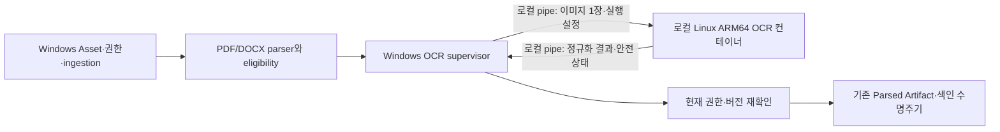

# 로컬 ARM64 OCR 실행 경계 설계

> 현재 상태(2026-10-12): **AMD64 유지, ARM64 전환 취소 및 실험 환경 정리.**
> 사용자의 명시적 취소에 따라 아래 ARM64 전환·의존성 해결·OCR 분리 제안과 후속 검증은
> 종료된 조사 이력으로 보존하며 진행 중 계획이나 실행 승인 요청으로 취급하지 않는다.
> 기존 AMD64·Gemma 제품 코드·서비스는 유지한다. 정리 결과는 비교 작업 기록의 마지막 절을 따른다.

- 상태: **사용자 취소로 종료된 설계 초안. 구현·설치·운영 전환하지 않음.**
- 기준일: 2026-10-12
- 승인된 이번 범위: 설계 문서와 읽기 전용 확인. 제품 코드·모델·DB·서비스 변경 없음.
- 목적: 기존 OCR 기능을 생략하지 않는 ARM64 구성을 준비하며 문서와 결과를 이 PC 안에서 처리한다.
- 상위 계약: [OCR 의미 프로파일](2026-09-06-rag-document-processing-ocr-profile-design.md),
  [RAG 설계](../../labs/rag/design.md), [전체 기능표](../../runbooks/arm64-feature-parity.md).
- 의존성 사실·독립 차단 정본: [ARM64 해결 계획](../../runbooks/arm64-dependency-resolution.md).

## 1. 결정 범위와 대안

구조상 후보는 Windows RAG worker가 소유하는 **로컬 Linux ARM64 OCR 컨테이너 어댑터**다.
11절의 공식 지원 조사에서 현재 고정 버전의 실행 적격 환경을 확정하지 못했으므로 설치 권고는 보류한다.
항상 실행되는 HTTP 서비스나 별도 DB를 만들지 않고 이미지 한 장마다 소유한 작업을
실행한다. Cold start 비용을 먼저 측정하고 재사용 풀은 이번 설계에서 제외한다.
현재 `OcrRuntimePort.recognize(OcrRequest, OcrProfileSpec) -> OcrResult` 계약을 유지한다.
PDF/DOCX 파싱·eligibility·provenance·권한·결과 저장·색인·READY 판정은 Windows에 남긴다.

| 대안 | 판단 |
| --- | --- |
| 로컬 Linux ARM64 컨테이너, stdin/stdout 전달 | 구조상 후보. 설치 권고 보류. 공식 Paddle3.2.2 cp313 ARM64 wheel 후보, 프로세스·파일·network·자원 경계의 검증 가능성이 있다. 실제 지원/실행은 미검증 |
| 일반 WSL 배포판에서 OCR 직접 실행 | 사용자 홈/Windows mount/네트워크·자식 종료를 별도 제한해야 한다. 검증 전 기본값으로 사용하지 않음 |
| Windows ARM64 Paddle 포팅 또는 backend 전체 Linux 이전 | 전자는 공식 지원 공백, 후자는 Windows 보호·복구 경계 재구현이 필요하므로 이번 최소 범위에서 제외 |

기존 `linux/amd64` 운영 Compose와 host 실행은 그대로 유지한다. 이 문서는 배포 정본을
ARM64로 바꾸지 않는다. 구현 전 승인된 ADR·구현 계획에서 로컬 어댑터 선택과 취소 전달
경로를 확정한다. Platform은 RAG OCR 구현에 의존하지 않는다.

현재 `backend/Dockerfile`의 `runtime-ocr-cpu`는 전체 backend와 embedding을 포함한다.
이를 그대로 전용 OCR image라고 부르거나 ARM64로 실행하지 않는다. 향후 전용 runner는
OCR 계약/정규화·필요 패키지만 조립하고 API/worker startup·DB 설정·sklearn/Gemma 경로를
끌어오지 않아야 한다. 이는 구성 분리 제안이며 기존 파일/target 변경은 이번에 없다.

## 2. 주체와 데이터 흐름

| 주체 | 소유 책임 | 허용하지 않는 접근 |
| --- | --- | --- |
| Windows ingestion | 현재 사용자/공간/Asset Version/프로파일, 작업 상태·멱등 키, 결과 commit | 컨테이너 결과를 권한 증명으로 신뢰하지 않음 |
| Windows supervisor | 로컬 엔진 판별, 컨테이너 생성 identity, pipe·예산·취소·종료 확인 | 다른 container/서비스 종료, 임의 shell 명령, 원격 Docker context |
| Linux runner | 입력 검증·PPStructureV3·출력 정규화·임시 파일 정리·로컬 deadline | DB/Redis/ES, Docker socket, Windows 홈/프로젝트/원본 저장소, 외부 network |
| 준비 단계 | 공식 패키지·승인된 모델 manifest로 재현 image 준비 | 문서 입력 포함, 실행 중 다운로드, 외부 registry에 image push |

컨테이너에도 비공개 이미지·OCR 본문이 들어간다. “원본 PDF를 보내지 않음”은 비민감화를
뜻하지 않는다. 문서 단위 저장 경로와 `source_part`는 Windows에서 opaque request ID에
매핑하고 컨테이너에는 전달하지 않는다. 공개 전시실은 이 실행 경로에 접근하지 않는다.

## 3. 실행 위치와 격리의 필수 사전조건

- 승인된 **이 PC의 Linux ARM64 엔진**만 허용한다. 원격TCP/SSH context 및 `DOCKER_HOST`
  override는 거부한다. named pipe라는 이유만으로 local identity가 증명됐다고 보지 않고
  Windows Desktop/VM과 엔진 identity의 매핑을 운영 담당자가 확인한다.
- image는 준비 단계에서 고정된 digest·linux/arm64·Python3.13·세 OCR pin 및 전체 의존성
  manifest로 식별한다. 실행 시 pull/build/install하지 않는다. digest 미준비면 unavailable.
- 컨테이너 network는 `none`, publish port 없음, host network/PID/IPC 없음. non-root UID,
  모든 capability 제거, no-new-privileges, read-only root, core dump 비활성, restart 없음.
  이 요구를 지원·검증할 수 없는 engine이면 문서 입력 전에 차단한다.
- Docker socket·호스트 디렉터리 bind mount·공유 데이터 volume 없음. 승인된 모델은
  로컬 전용 image layer에 정확한 hash로 준비한다. image와 모델은 외부 push 대상이 아니다.
  런타임 다운로드·telemetry·crash upload는 비활성화하고 network 차단을 합성 검사로 확인한다.
- 데이터 파일은 제한된 `/work` tmpfs에만 생성한다. 패키지 cache/home/tmp를 이 경로로
  고정하고 실행 파일이 필요한 cache가 있다면 read-only image 준비 단계에서 해결한다.
- container log driver는 `none`; pipe의 원문·stderr·SDK 로그를 Docker/애플리케이션 로그에
  저장하지 않는다. runner가 native stdout/stderr를 별도 drain·폐기하고 protocol 출력만
  전용 FD에서 내보낸다. 예외 문자열 대신 allowlist safe code만 반환한다.
- VM swap/host pagefile·덤프·백업/동기화도 데이터 잔류 범위에 포함한다. 컨테이너 swap
  금지만으로 VM 저장을 없앴다고 주장하지 않는다. 기존 로컬 저장 보호/백업 정책 충족을
  운영 담당자가 확인하기 전에는 합성 입력만 허용한다. 이번 정책 설정 변경은 없다.

[Docker network none](https://docs.docker.com/engine/network/drivers/none/) 및
[자원 제한](https://docs.docker.com/engine/containers/resource_constraints/)은 격리 수단의
근거다. 해당 기능 존재가 현재 엔진의 적용 성공이나 문서 반출 방지 검증을 대신하지 않는다.

## 4. 입력·출력과 허용 범위

1. Windows가 기존 opened-handle·권한 규칙으로 원본에서 파생된 이미지를 읽고 실제 byte
   hash·크기·MIME·pixel 수를 확인한다. pipe에는 승인된 이미지 하나만 넣는다. 임의 URL,
   UNC/Windows/Linux 경로, shell 조각, pickle, 임의 모델 경로는 protocol에서 받지 않는다.
2. 새 버전의 bounded frame protocol을 사용한다: 길이 prefix + JSON header + 이미지 bytes.
   header는 protocol version, 무작위 attempt ID/nonce, image hash/크기/MIME/폭/높이,
   불변 OCR semantic fingerprint, model-manifest digest, CPU 실행·시간/출력 한도를 갖는다.
   환경 절대 경로·사용자 정보·문서 제목·원문은 header에 없다. nonce는 보안 로그에 남기지 않는다.
   **이미지 frame 완료가 stdin EOF를 뜻하지 않는다.** Windows는 terminal 응답과 exit까지
   제어 stdin을 열어 두고, runner는 정확한 frame 길이로 입력 완료를 판정한다. 이후에는
   같은 attempt에 대한 취소 control frame만 허용한다. 실행 중 EOF는 부모/attach 상실로
   간주해 취소하고, 정상 종료 후 pipe close는 추가 취소를 만들지 않는다. 부분 frame EOF,
   완료 frame 뒤 조기 EOF, 정상 terminal 뒤 close를 서로 다른 테스트로 검증한다.
3. runner는 내장 profile manifest와 요청 fingerprint의 일치를 먼저 확인한다. 열 개 모델
   binding과 기존 PPStructureV3 플래그를 모두 유지하고 임의 설정 확장/동적 코드를 거부한다.
   nonce는 상대 인증의 대체가 아니다. 신뢰의 근거는 승인된 engine·image·생성된 pipe 소유권이다.
4. runner는 입력 frame 완료/hash 일치 후 `/work/input`에 생성하고 output은 메모리에서
   정규화한다. `OcrResult`의 text_units/table_cells/warnings와 정규화 bbox, confidence,
   evidence_eligible을 유지한다. 현재 nullable row/column 값에 없는 구조 정보를 만들지 않는다.
5. 응답은 attempt ID/nonce·input/profile/manifest hash를 echo하며 result 또는 safe error 중
   하나만 포함한다. Windows는 byte/항목 한도, finite confidence/좌표, `[0,1]` bbox 순서,
   schema·warning code를 재검증한다. 잘못된 출력·여분 frame·stdout 오염은 전부 실패다.
6. 결과 도착 후 현재 Asset Version·권한 revision·취소·supersession을 기존 transaction과
   lock 순서로 재확인한다. 과거 권한/늦은 결과는 저장하지 않는다. 경합 판정과 commit은
   Windows만 수행한다. OCR 완료만으로 Platform Asset 또는 RAG Projection을 READY로 만들지 않는다.

기존 port가 동기 호출이므로 구현 시 ingestion의 취소 신호를 supervisor에 전달하는
명시적 제어 경로가 필요하다. thread/future 취소만으로 native 작업이 종료됐다고 간주하지
않는다. 공개 API를 먼저 바꾸지 않고 내부 composition에서 cancellation/deadline handle을
전달하는 설계를 구현 계획에서 테스트와 함께 확정한다.

## 5. 작업 상태·취소·실패·재시도

아래는 어댑터 내부 상태이며 새 DB schema나 현재 사용자 상태를 임의로 추가하지 않는다.
작업 기록에 필요한 필드가 현재 저장 계약에 없으면 구현 전에 영향·migration을 별도 검토한다.

| 사건 | 처리·종료 조건 | 재시도 |
| --- | --- | --- |
| dispatch 전 | 현재 source·권한 확인, 자원·image·engine 검사; admission 실패는 데이터 전달0 | transient 자원 부족만 기존 bounded 정책으로 재예약 |
| create/start | create 전에 engine·attempt·예정 owner identity를 보호 journal에 durable 기록; 응답 후 exact container ID·created time 결속 | create 응답 유실이면 소유 identity부터 조정; 미확인 채 재생성 금지 |
| running 성공 | output 검증 후 프로세스 exit0·container non-running 확인; 권한 재검증 후 결과 commit | 같은 멱등 key의 재사용은 원자적으로 한 결과만 채택 |
| 취소/timeout | 결과 수락 즉시 중단, 소유 컨테이너 TERM→5초 grace→KILL, 정지 확인 후 cancelled/timeout 종결 | 사용자 취소는 자동 재시도0; timeout은 자동 확대/재시도0 |
| host crash/pipe EOF | Linux runner 자체 wall deadline과 EOF watcher가 PID1 종료·자식 정리를 유도 | 재기동 supervisor가 exact identity·기존 job 상태 조정 후만 판단 |
| OOM/PID/출력 한도 | 부분 결과 폐기, safe code로 실패; 누락된 OCR을 성공으로 처리하지 않음 | 자동 상한 증대·다른 모델/AMD64 fallback0 |
| model/profile/schema/정책 오류 | 해당 문서 OCR 실패, 이전 유효 결과·원본 보존 | 비재시도; 구성/정책 소유자 조치 필요 |
| engine disconnect/정지 증거 없음 | `termination_unknown` 내부 진단, 해당 슬롯 차단; 완료/정리 성공 주장 금지 | 자동 새 attempt0; 운영 확인 후만 회복 |
| 낮은 confidence | 기존 경고와 evidence 제외 규칙 적용; 모든 eligible 이미지 처리 여부 판정 | 다른 모델로 재실행하지 않음 |

재시도 가능 transient 통신 오류도 기존 정책 한도와 **추가 1회 이하** 중 작은 값을
적용하고, 전체 원래 deadline 안에서만 실행한다. 시도마다 새 nonce/attempt identity를
사용한다. OCR 재사용 key는 기존 Asset Version·이미지 hash·OCR Profile에 runtime image/
manifest fingerprint를 포함해 서로 다른 환경의 결과를 검증 없이 섞지 않는다.

Windows Job은 소유 CLI/감시 프로세스만 관리한다. CLI가 끝나도 컨테이너 종료는 별도다.
container create 전에 engine ID·attempt ID·예정 고유 이름/owner label·image digest·시각을
보호 journal에 원자적으로 기록·flush하고 성공해야 create한다. create 응답 유실 시에는
동일 승인 engine에서 그 identity에 정확히 일치하는 container만 조회하여 **유일한 한 개**의
ID/created time/image/label을 대조·결속한다. 0개여도 create 미실행이 확정되지 않으면
재생성하지 않고 unknown으로 남긴다. 여러 개·metadata 불일치도 unknown이며 중단/삭제0.
start 전 exact ID 결속을 durable 완료한다. 따라서 실행된 작업의 소유권은 이름 추측에
의존하지 않는다. journal에는 원문·이미지·pipe nonce를 저장하지 않는다.
정지 증거는 정확한 engine/container identity의 terminal state·wait exit·OOM flag이며,
합성 검증에서 fork된 자식까지 namespace/cgroup에서 사라짐을 확인해야 한다. control API를
잃었을 때는 runner 자체 deadline이 있어도 관찰 전까지 `termination_unknown`으로 남긴다.
worker 재시작은 다른 컨테이너 전체 목록을 청소하지 않고 자신이 기록한 exact identity만
대조한다. 실행 중 owner journal이 유실되면 추정 이름/PID로 중단하지 않는다.

## 6. 파일·산출물 수명주기와 자원

| 대상 | 수명·정리 |
| --- | --- |
| 기존 원본/파싱/cache/모델 | 기존 보존 정책 적용. OCR 실행기가 삭제하거나 덮어쓰지 않음 |
| Windows 이미지·pipe buffer | 현재 parser의 작업 소유 temporary contract 유지. 전송용 영속 복사본을 추가하지 않음 |
| Linux input/output/scratch | `/work` tmpfs만 사용. 성공/실패 finally에서 제거, container 종료 확인 후 tmpfs 소멸 확인. crash 잔류는 exact 소유 container 정지 후 처리 |
| 실행 metadata | 내부 attempt·hash·safe code·소요·리소스·종료 증거만 기존 비공개 기록에 남김. 원문·경로·예외 text 제외 |
| container/image | 작업 container만 terminal 확인 후 제거. image/모델/cache 제거는 CACHE_POLICY 승인·재검증 절차. prune/공유 volume 삭제 금지 |

삭제는 저장 매체의 물리 소거를 보증하지 않는다. 로그·VM 저장 보호 조건은 3절을 따른다.
다음은 **합성 feasibility의 초기 예산 제안**이며 품질/속도/전체 모델 메모리 요구의 실측이 아니다.

| 항목 | 초기 제안·거부 조건 |
| --- | --- |
| 동시성 | 전체 OCR1·컨테이너당 이미지1. 무제한 queue/buffer를 만들지 않고 기존 job에 대기 상태 반영 |
| 입력 | encoded32MiB·25MP·한 변10,000pixel 중 하나 초과 시 실패. 조용한 축소/잘라내기 금지 |
| 출력 | JSON8MiB·총 text/table 항목50,000·header64KiB. 초과하면 전체 이미지 실패 |
| 계산 | 2CPU·memory4GiB·memory+swap4GiB·PID128·tmpfs256MiB; 실제 engine 적용 확인 필수 |
| 시간 | input60초·전체300초(시작/로드 포함), 종료 grace5초. 다음 단계 실제 모델 평가는 별도 예산 승인 |
| 호스트 | 여유 물리RAM6GiB 이상·VM 잔여 예산 확인 후 admission. 여유2GiB 미만이면 해당 OCR만 중단; 기존 사용자 앱 종료0 |

이전1.64GiB 여유 측정은 과거값이다. 실행 전에 다시 확인해야 하며 OCR 예산을 frontend
build 예산과 동시에 배정하지 않는다. cgroup 제한 지원을 확인할 수 없으면 시작하지 않는다.

## 7. 검증과 rollback

| 단계 | 통과 증거 | 지금 상태 |
| --- | --- | --- |
| 문서 검토 | port·프로파일·보호/권한·비반출·실패/종료·자원·rollback의 독립 검토 | 이번 범위 |
| 패키지 정적 확인 | 공식 hash·Linux ELF·wheel metadata·필수 native dependency 목록 | 2026-10-12 완료. 혼합 아키텍처·ABI/외부 라이브러리 문제 발견; 아래10절. 설치/호환성 통과 아님 |
| 모델 없는 fake runner | frame truncation/오염·hash/profile mismatch·경로 공격·과대 입력·재전송·권한 철회·supersession·취소 경합 | 미구현·미실행 |
| 로컬 격리 수용 | network/ports/mounts/log 부재, readonly/non-root/cgroup 적용, fork 자식·EOF/timeout/OOM·daemon 단절·재기동 cleanup | 별도 환경 실행 승인 필요 |
| 실제 OCR | 동일 승인 모델 10종·공개 합성 DOCX/스캔/혼합 PDF로 본문/표/좌표/신뢰도와 P95/peak 비교 | 모델 승인 전 미실행 |
| 전체 서비스 | frontend/API/worker/DB/Redis/ES·검색/생성·취소/복구와 본래 환경 반영 | OCR 성공과 별개로 전체 기능표 적용 |

실제 OCR 수용은 기존 평가 snapshot에서 원문 위치 왕복·권한·표 필수 fixture 누락0,
일관된 confidence/evidence 판정, 실패/부분 처리 기록을 요구한다. CER/WER·표 품질과
P95 허용 차이는 실행 전 같은 평가 계획에서 수치로 승인받는다. 이번에 임의 값을 넣어
통과를 선언하지 않는다. 과거 unit/mock 테스트를 해당 통합 수용 증거로 재사용하지 않는다.

ARM64 어댑터는 명시적으로 선택된 deployment에만 적용하며 자동 기본값 승격/자동 fallback
없다. rollback은 신규 admission 정지→소유 실행 terminal 확인→기존 검증된 AMD64 선택을
운영자가 명시적으로 복원하는 순서다. 원본·기존 색인·계정·AMD64 설치는 유지한다.
미완료 OCR 산출물을 활성 색인에 섞지 않으며 schema 변경 없는 검증 단계에는 DB rollback도
없다. 향후 schema 변경이 필요하면 독립 migration 계획을 먼저 승인받는다.

## 8. 독립 차단과 이번 환경 조회 결과

- **cryptography:** 현재50.x Windows ARM64 wheel 공백. 공식51 배포/ABI/보호 경로 검증과
  `<51` 제약 변경 검토가 별도다. OCR 분리로 API/worker 필수 import가 해결되지 않는다.
- **Windows DLL:** sklearn의 기존 App Control3033/3077 차단은 정책 소유자 판정 필요.
  이 컨테이너로 sklearn/Gemma를 옮겨 차단을 피하지 않는다.
- **전체 플랫폼:** libpq·전체 backend native 의존성·frontend build 메모리·기존 RAG 운영
  복구 미완료·서비스 실제 통합은 그대로 남는다. ARM64 전체 완료가 아니다.
- **이번 Docker 읽기:** CLI29.5.3/windows/arm64 정보는 반환됐으나 사용자 Docker config
  및 daemon named pipe 접근은 거부됐다. `Server:null`, exit1. 출력된 default context는
  실제 활성 Linux 엔진의 증거가 아니다. 다른 context/WSL·권한 승격으로 재시도하지 않았다.
  서버 버전·실행 컨테이너·WSL 배포판·추가 disk footprint는 미확인이다.

## 9. 이번에 완료한 정적 확인 범위

**공식 Paddle3.2.2 Linux ARM64 wheel 한 개의 다운로드·정적 검사를 수행했다.** 환경 식별이
막힌 상태에서 실제 Docker/WSL 설치 대상으로 추측한 배포판을 제시하지 않는다.
이는 기존 호환성 조사 요청 범위이며 별도의 설치 승인 대상이 아니었다.

| 항목 | 수행 범위와 제한 |
| --- | --- |
| 다운로드 대상 | `paddlepaddle-3.2.2-cp313-cp313-manylinux2014_aarch64.whl` 1개. 공식 PyPI JSON의 해당 filename URL만 사용 |
| 확인 가능한 용량 | metadata상88,143,036bytes(약84.06MiB), SHA256 `b03569ba151ac50aa730955c65dfa571fe7ae71f94574c94e8bfe5e0913a7d9c`. 다운로드 전 fresh metadata 불일치면 중단 |
| 저장/설치 대상 | `.local-data/project-agent-work/ocr-arm64-wheel-preflight-20261012/`에 보존. **설치 대상 없음**: 기존/새 Python site-packages, WSL, Docker에 설치0 |
| 검사 | 파일 hash·ZIP 경로/크기·WHEEL/METADATA/RECORD·ELF header의 AArch64·직접 의존성 목록을 정적 읽기. import/실행/추론/전체 dependency 다운로드0 |
| 예산 | 디스크256MiB 여유를 작업 예산으로 예약(추정). extract 없이 streaming 검사, 항목/누적 uncompressed 크기와 시간 상한을 설정해 초과 시 실패. 실제 확장 크기는 검사에서 보고 |
| 설정/서비스 영향 | 전역 PATH·lock·패키지·OS/엔진/보안 설정 변경0, 서비스 시작·중단0, DB/문서 접근0. 공개 패키지 다운로드에만 네트워크 사용 |
| 성공과 다음 판단 | 공식 파일의 무결성·native architecture·dependency 요구 보고. 설치 성공/PPStructureV3/OCR 동등성으로 표시하지 않음. 이후 실제 로컬 엔진 식별과 전체 의존성/image 용량을 확보해 별도 실행 승인 |

다운로드와 헤더 검사는 실행했지만 wheel/engine 준비 및 모델 없는 실행 검증은 미완료다.
공개 합성 입력 실행이나 문서 처리로 진행하지 않았다. 문서 실행 단계에서 인터넷을 허용하지 않는다.
공식 파일 근거: [Paddle3.2.2 메타데이터](https://pypi.org/pypi/paddlepaddle/3.2.2/json).

## 10. 정적 검사 결과와 새 실행 차단

공식 PyPI의 filename·size·SHA256·yanked 여부를 다시 확인하고 해당
`files.pythonhosted.org` HTTPS 파일만 내려받았다. 전체88,143,036바이트 SHA는9절과
일치했다. ZIP3315개 경로의 traversal·절대/Windows 경로·중복·symlink·암호화·크기 한도
검사를 통과했다. 압축 해제·설치·import·바이너리 실행·`ldd` 호출은 하지 않았다.
RECORD3315행의 경로는 읽었지만 모든 member의 개별 hash/전체 CRC를 검사한 것은 아니다.

| 확인 항목 | 실제 결과·해석 |
| --- | --- |
| Python ABI | 파일명은 `cp313-cp313-manylinux2014_aarch64`; 내부 WHEEL은 `cp313-cp313-linux_aarch64`. CPython3.13 전용 태그이며 abi3가 아니다. METADATA의 Requires-Python은 없음 |
| ELF 헤더 | `.so` 이름의13개 ELF64 little-endian 중 AArch64(e_machine183)9개, x86-64(62)4개 |
| x86-64 파일 | `paddle/libs/libblas.so.3`, `libgfortran.so.3`, `liblapack.so.3`, `libquadmath.so.0`. 공식 archive hash가 맞아도 모든 바이너리가 ARM64인 것은 아님 |
| 핵심 연결 | `libpaddle.so`와 bundled DT_NEEDED 연결의 `libpir/libphi/libphi_core/libcommon`은 ARM64. 위4개 x86-64 파일은 이 연결 그래프에는 나타나지 않음. 동적 dlopen·Python preload·연산별 사용 여부는 미확인 |
| GLIBC/C++ ABI | ARM64 `libphi_core.so`와 warp 계열은 `GLIBC_2.27`을 요구. 관찰한 C++ 요구에는 `GLIBCXX_3.4.22`, `CXXABI_1.3.11` 포함. 파일명만으로 glibc2.17 호환을 가정할 수 없음 |
| 외부 Fortran | ARM64 `libopenblas.so.0`은 **`libgfortran.so.4`/`GFORTRAN_7`**을 요구하지만 wheel에 해당 library 없음. 포함된 x86-64 libgfortran.so.3은 ABI·아키텍처 모두 대체재가 아님 |
| 기타 외부 이름 | `ld-linux-aarch64.so.1`, `libc.so.6`, `libgcc_s.so.1`, `libgomp.so.1`, `libm.so.6`, `libpthread.so.0`, `librt.so.1`, `libstdc++.so.6`. 각 native ABI와 host의 실제 제공 여부는 미검증 |
| 검색 경로 | 일부 RPATH에 `$ORIGIN` 및 NVIDIA 경로가 있음. 검색 경로만으로 CUDA가 필수이거나 GPU 실행이 가능하다고 판정하지 않음 |
| Python 직접 의존성 | httpx, numpy>=1.21, protobuf>=3.20.2, Pillow, opt-einsum==3.3.0, networkx, typing-extensions, safetensors>=0.6.0. 이들의 전이 의존성·PaddleOCR/PaddleX 전체 closure는 미검증 |
| 저장 크기 | wheel 약84.06MiB, 검사 폴더 약84.1MiB로256MiB 예산 이내. ZIP에 선언된 비압축 합계334,392,098바이트(약318.90MiB)는 실제 추출/설치량이 아님; 추출 파일0 |

[manylinux2014 기준](https://peps.python.org/pep-0599/)의 GLIBC2.17·GLIBCXX3.4.19·
CXXABI1.3.7 상한과 실제 version need가 다르므로 배포 태그의 호환성 주장을 검증 통과로
사용하지 않는다. 이 분석은 정적 요구사항 확인이며 특정 Linux에서 import가 실패했다고
실험한 결과는 아니다. 이름 차집합만으로 host linker의 탐색·해결을 증명하지 않는다.

**판정: 다운로드·정적 검사는 완료, ARM64 실행 적합성은 보류.** 이 wheel을 검증된
OCR image 기반으로 승격하거나 혼합 파일을 임의로 삭제/교체하지 않는다. 후속 조사에서는
공식 배포 근거·실제 로딩 요구·ARM64 Fortran ABI 공급을 먼저 해소해야 한다. source build,
다른 버전 도입이나 실제 Linux 실행은 이번 범위 밖이다. Docker 접근 거부는 재시도하지 않았다.
cryptography·Windows DLL 정책·libpq·frontend/전체 통합 차단도 별개로 유지한다.

원자료는9절 검사 폴더의 `official-source.json`, `download.json`, `elf-headers.json`,
`static-report.json`, `findings.json`이다. 독립 리뷰가 별도 ZIP header 읽기로 핵심 ARM64와
네 x86-64 파일을 확인했다. 새 배포 artifact 문제는 작업 기록에 누적했고, 운영 문제 이력
DB 반영은 이번 DB 변경 금지 범위 때문에 미완료다. 새 ISSUE 번호를 임의로 발급하지 않는다.

## 11. 공식 지원 경로 최종 조사 — 고정 버전 실행 보류

2026-10-12 기준 Python3.13·Paddle3.2.2·PaddleOCR3.7.0·PaddleX3.7.2를 유지한
**일반 CPU Linux ARM64의 구체적인 공식 지원 환경을 확인하지 못했다.** 공식 wheel의
존재와 실행 지원은 구분한다. 이는 모든 ARM64 실행이 불가능하다는 증명이나 이 PC의
import 실패 관측이 아니다. 현재 증거로 설치·실행 단계에 진입할 환경을 선정하지 않는다.

| 확인 대상 | 근거와 한계 |
| --- | --- |
| 공식 CPU 배포 목록 | [stable CPU index](https://www.paddlepaddle.org.cn/packages/stable/cpu/paddlepaddle/)에 3.2.2 cp313 `linux_aarch64`가 있다. HEAD200·88,143,036바이트·2025-11-11 수정시각을 확인했다. 기존 PyPI wheel과 크기는 같지만 CDN SHA256이 제공되지 않아 동일 내용 또는 수정판이라고 단정하지 않는다. 본문 다운로드0 |
| 일반 설치 문서 | [release/3.2 PIP 안내](https://github.com/PaddlePaddle/docs/blob/release/3.2/docs/install/pip/linux-pip_en.md)는 3.2.2·Python3.9~3.13을 명시하지만 CPU는 x86_64/MKL/AVX 경로다. [설치 개요](https://github.com/PaddlePaddle/docs/blob/release/3.2/docs/install/index_en.rst)는 Ubuntu20.04/22.04·AlmaLinux8과 x86_64를 기술한다. ARM wheel 배포와 문서 범위가 일치하지 않으므로 임의로 ARM 지원 행렬을 보충하지 않는다 |
| 공식 완성 이미지 | [3.2 Docker 안내](https://github.com/PaddlePaddle/docs/blob/release/3.2/docs/install/docker/linux-docker_en.md)의 Python은3.10. [Docker Hub 3.2.2 태그 메타데이터](https://hub.docker.com/v2/repositories/paddlepaddle/paddle/tags?page_size=100&name=3.2.2)의 CPU·Jupyter·GPU4종 총6개는 모두 linux/amd64다. CPU digest는 `sha256:ea4cb70748dcbc15ec354aa17e2c30ecd92e7b9ce13c23f5605f9c4faa31155f`, 표시 크기1,787,540,375바이트. manifest 레이어 다운로드·daemon 호출0. 별도 Baidu registry manifest는 미조회이므로 그 내용까지 동일하다고 단정하지 않는다 |
| 공식 ARM 소스 빌드 안내 | [FT2000+/Kunpeng 안내](https://github.com/PaddlePaddle/docs/blob/release/3.2/docs/install/compile/arm-compile.md)는 KylinV10/UOS·Python3.8~3.10·develop 소스 빌드 경로다. 이 PC의 CPU·Python3.13·고정 wheel 조합의 수용 증거가 아니며 소스 빌드는 이번 범위 밖이다 |

### 혼합 라이브러리는 연산에 따라 필요한 패키징 결함

[이슈78118](https://github.com/PaddlePaddle/Paddle/issues/78118)은 2026-03-03에
3.3.0 cp313 ARM wheel의 동일한 x86 라이브러리4개와 libgfortran.so.4 부재를 보고했다.
조회 시 open이며 유지관리자의 확인 요청만 있다. 이 보고는 다른 버전의 보강 근거이고,
우리 3.2.2 파일의 사실은 10절 직접 정적 검사로 뒷받침한다.

[v3.2.2 lapack.h](https://github.com/PaddlePaddle/Paddle/blob/v3.2.2/paddle/phi/backends/dynload/lapack.h)의
wrapper는 최초 연산 호출 때 call_once로 핸들을 얻고 dlsym으로 심볼을 찾는다.
[loader](https://github.com/PaddlePaddle/Paddle/blob/v3.2.2/paddle/phi/backends/dynload/dynamic_loader.cc)는
Linux에서 liblapack.so.3을 요청한다. CPU eig/SVD/lstsq 등의 경로가 이를 사용한다.
따라서 import의 직접 의존성에서 빠져 있다는 사실은 무해하거나 삭제 가능한 선택 구성이라는
뜻이 아니다. 현재 OCR 열 개 모델이 해당 연산을 전혀 쓰지 않는지도 검증되지 않았다.

공식 [PR79516](https://github.com/PaddlePaddle/Paddle/pull/79516)은 CPU eigvalsh 재현을
제시하며 ARM용 LAPACK 배포물 선택과 패키징을 수정했다(2026-07-20 develop 병합).
[PR79518](https://github.com/PaddlePaddle/Paddle/pull/79518)은 release/3.4로
2026-07-21 병합됐다. 확인한 v3.2.2와 release/3.2의 lapack.cmake는 Linux ARM 분기가
없는 이전 구성이며 수정판3.2.2 배포 근거는 찾지 못했다. 3.4 소스 수정은 3.2.2 wheel의
수정이나 3.4 배포 wheel의 전체 ABI 해결을 보증하지 않는다. 버전 상향은 미승인이다.

### ABI 조합과 다음 조건

- GLIBC2.27·GLIBCXX3.4.22·CXXABI1.3.11은 검사한 파일의 **관측 요구값**이며 공식
  ARM 지원 최소치가 아니다. 일반 설치 문서의 GCC8/libstdc++ 안내 역시 이 ARM wheel의
  libgfortran.so.4/GFORTRAN_7 조합을 지정하지 않는다.
- [이슈73523](https://github.com/PaddlePaddle/Paddle/issues/73523)은 Paddle3.0/CentOS7의
  GLIBC2.27 오류다. collaborator는 Docker 사용을 권했지만 glibc 직접 업그레이드 답변은
  일반 사용자 제안이다. 이를 ARM64 cp313 공식 지원 절차로 채택하지 않는다.
- [v3.2.2 OpenBLAS 구성](https://github.com/PaddlePaddle/Paddle/blob/v3.2.2/cmake/external/openblas.cmake)은
  기본 비Windows 외부 빌드에 정적 링크 경로를 두지만
  [system OpenBLAS 선택](https://github.com/PaddlePaddle/Paddle/blob/v3.2.2/cmake/cblas.cmake#L61)과
  [aarch64 공유 라이브러리 패키징](https://github.com/PaddlePaddle/Paddle/blob/v3.2.2/setup.py#L1447)
  분기도 있다. 소스만으로 검사 wheel의 실제 빌드 기원을 증명하지 못한다.
  glibc가 충분한 배포판을 고르는 것만으로 혼합 LAPACK와 Fortran ABI 문제가 해결되지 않는다.
- 즉시 요청할 설치 승인 대상은 **없다**. 다음은 upstream의 고정 버전 수정 배포물·지원
  OS/CPU/Python/Fortran 조합 확인, 또는 별도 승인된 버전 상향의 메타데이터 조사다.
  임의 .so 교체·심볼릭 링크·LD_LIBRARY_PATH 변경·재빌드·에뮬레이션을 해법으로 실행하지 않는다.
- 추후 후보가 확인되면 승인 요청은 정확한 linux/arm64 image digest·CPython3.13·패키지
  hash/lock·네이티브 의존성 목록·다운로드/디스크/메모리 예산을 포함해야 한다. 초기 실행은
  소유한 임시 컨테이너 하나에서 import/run_check와 합성 선형대수 검사로 제한하고 모델·실제
  문서·DB는 제외한다. 현재 digest/전체 closure가 미확정이므로 이 범위도 아직 실행하지 않는다.

공식 텍스트·JSON·HEAD 근거는 `.local-data/project-agent-work/ocr-arm64-official-support-20261012/`에
보관했다. 기존 wheel 반복 다운로드/설치/실행0, 새 wheel/image layer0, 모델/DB/서비스/정책 변경0.
Docker 접근 거부 이후 daemon 재시도0이며 Windows 보호·cryptography·전체 RAG 검증 차단은 유지한다.
